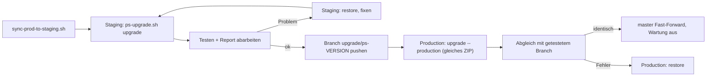

# PrestaShop Upgrade Toolkit (`ps-upgrade.sh`)

Sichere und wiederholbare PrestaShop-Core-Upgrades über die Kommandozeile. Das Toolkit übernimmt:

- **Vorab-Prüfungen und Reports:** Umgebung, PHP, Speicherplatz, Git, Core-Integrität, Overrides, Module, Theme, Child-Theme
- **Backups** ohne den riesigen Ordner `img/` und einen **einfachen Restore**
- den **Wartungsmodus** mit automatischer IP-Freigabe
- das eigentliche Upgrade über die **offizielle Update-Assistant-CLI** (`autoupgrade`) mit einem lokal geprüften Release-Paket
- **Smoke-Tests**, einen **Git-Abgleich** zwischen Staging und Production und ein vollständiges **Logging**

Das Toolkit ist generisch: Fast alles wird automatisch erkannt. Projektspezifisches steht ausschließlich in der `.env`.

---

## Inhalt

1. [Konzept](#1-konzept)
2. [Voraussetzungen](#2-voraussetzungen)
3. [Einrichtung & `.env`](#3-einrichtung--env)
4. [Befehlsreferenz](#4-befehlsreferenz)
5. [Ablauf: Patch-/Minor-Upgrade (Staging → Production)](#5-ablauf-patch-minor-upgrade-staging--production)
   - [Erste Schritte & Todos für die ersten Tests (8.2.1 → 8.2.9)](#51-erste-schritte--todos-für-die-ersten-tests-821--829)
6. [Ablauf: Major-Upgrade inkl. Theme (z.B. 8.2 → 9.x)](#6-ablauf-major-upgrade-inkl-theme-zb-82--9x)
7. [Backup & Restore](#7-backup--restore)
8. [Report-Symbole](#8-report-symbole)
9. [Logs & Reports](#9-logs--reports)
10. [Troubleshooting](#10-troubleshooting)
11. [Einsatz bei anderen Projekten](#11-einsatz-bei-anderen-projekten)

---

## 1. Konzept

| Was | Wie |
|---|---|
| **Upgrade-Engine** | Die offizielle Update-Assistant-CLI (`modules/autoupgrade/bin/console update:start`). Nur so laufen die DB-Migrationen (SQL **und** PHP-Callbacks) korrekt. Die alten Skripte `get-/run-sql-migrations.sh` führen nur SQL aus und sind deshalb **nicht** mehr zu verwenden. |
| **Release-Quelle** | Die offizielle Distributions-API `https://api.prestashop-project.org`, dieselbe Quelle, die auch der Update Assistant nutzt. 8.x ist die Open-Source-Edition, 9.x die „Classic Edition“. Die API liefert auch die PHP-Bereiche und MD5-Prüfsummen. |
| **Reproduzierbarkeit** | Das Release-ZIP wird **einmal** geladen, per MD5 verifiziert und mit SHA256 in `ps-upgrade/releases/` abgelegt. Production nutzt nachweislich **dasselbe** ZIP wie vorher Staging. |
| **Backups** | Werden vom Toolkit selbst erstellt, nicht vom Update Assistant: `tar.gz` des Docroots ohne `img/` plus vollständiger DB-Dump plus Manifest mit SHA256. |
| **Richtige PHP-Version** | Das Toolkit fragt die PHP-Version des **Webservers** ab und wählt das passende CLI-Binary. Ein `php`-Shim sorgt dafür, dass auch die intern verketteten autoupgrade-Schritte (die hart `php` aufrufen) diese Version nutzen. |
| **Strategie** | Immer zuerst auf **Staging** (frische Kopie von Production via `sync-prod-to-staging.sh`), dann mit identischem ZIP auf **Production**. |



**Was das Toolkit bewusst NICHT macht:**
- Theme-Dateien oder Child-Theme-Overrides automatisch aktualisieren. Es **listet** auf, was zu prüfen ist.
- Overrides automatisch anpassen. Es meldet, welche betroffen sind.
- Den PrestaShop-Cache im Back-Office leeren. Es leert nur `var/cache` und OPcache.

---

## 2. Voraussetzungen

- SSH-Zugang zum Server und `bash` (Linux oder FreeBSD, GNU- und BSD-Tools werden unterstützt)
- CLI-Tools: `mysql`, `mysqldump`, `tar`, `gzip`, `rsync`, `curl`, `git` (wird alles geprüft)
- Ein PHP-CLI-Binary in **derselben Major.Minor-Version wie der Webserver**, mit den Extensions `zip`, `tokenizer` und `json`
- Modul `autoupgrade` (Update Assistant) in `modules/autoupgrade`. Aktualisieren mit `./ps-upgrade.sh autoupgrade-update`.
- Der Ordner `helper/` liegt im Shop-Root (als Git-Submodule). `helper/env-check.php` muss per HTTPS erreichbar sein. Den nötigen `.htaccess`-Freigabeblock bringt das Toolkit mit.

---

## 3. Einrichtung & `.env`

```bash
cd /home/docutife/www/staging/helper     # bzw. production/helper
cp .env.example .env                     # falls noch nicht vorhanden (wird auch vom Sync-Skript genutzt)
chmod 600 .env
chmod +x ps-upgrade.sh ps-backup.sh ps-restore.sh
./ps-upgrade.sh info                     # zeigt, was erkannt wurde
```

Für Betz genügt in der Regel diese `.env`:

```bash
PROD_DIR=/home/docutife/www/production
STAGING_DIR=/home/docutife/www/staging
BACKUP_DIR=/home/docutife/www/backups
SMOKE_HTTP_AUTH="user:passwort"          # Basic-Auth von Staging (für die Smoke-Tests)
```

### Alle Variablen

| Variable | Standard | Automatisch erkannt? | Beschreibung |
|---|---|---|---|
| `PROD_DIR` / `STAGING_DIR` | – | – | Pfade der Umgebungen, dienen zur Erkennung, ob das Skript in Staging oder Production läuft. Symlinks werden aufgelöst. |
| `PS_ENV` | – | ✅ über die Pfade | Erzwingt `staging` oder `production`. **Ohne jede Konfiguration gilt Production** (maximale Vorsicht). |
| `PS_ROOT` | `helper/..` | ✅ | Shop-Root |
| `ADMIN_DIR` | – | ✅ Ordner mit `themes/new-theme` + `index.php` | Name des Admin-Ordners |
| `BACKUP_DIR` | `<Elternordner des Shops>/backups` | – | Basisordner. Das Toolkit arbeitet **nur** in `<BACKUP_DIR>/ps-upgrade/`. Muss außerhalb des Docroots liegen. |
| `BACKUP_KEEP` | `5` | – | Anzahl der Backup-Sets pro Umgebung (Rotation betrifft nur Toolkit-Sets) |
| `BACKUP_EXCLUDE_PATHS` | – | – | Zusätzliche Pfade ohne Backup (relativ zum Root, mit Leerzeichen getrennt) |
| `MAINTENANCE_IPS` | – | – | Zusätzliche IPs für den Wartungsmodus (kommagetrennt), z.B. die IPv6 deines Browsers |
| `SMOKE_HTTP_AUTH` | – | – | `user:pass` für Basic-Auth-geschützte Umgebungen (Smoke-Tests) |
| `PHP_BIN` | – | ✅ passend zur Web-PHP | Erzwingt ein PHP-CLI-Binary |
| `WEB_PHP_VERSION` | – | ✅ über `env-check.php` | Fallback, falls `env-check.php` nicht erreichbar ist (z.B. `8.2`) |
| `ENV_CHECK_TOKEN` | – | ✅ wird erzeugt | Token für `helper/env-check.php` |
| `THEME_NAME` | – | ✅ `shop.theme_name` | Aktives Theme |
| `THEME_PARENT` | – | ✅ `parent:` in der `theme.yml` | Parent-Theme |
| `THEME_MODULES` | – | ✅ `dependencies.modules` der `theme.yml` | Mit dem Theme gelieferte Module (Liste oder Globs, z.B. `"iqit* ph_*"`) |
| `THEME_MIN_VERSION_FOR_PS<N>` | – | ✅ über die Theme-Pakete | Mindestversion des Parent-Themes für PrestaShop-Major N, z.B. `THEME_MIN_VERSION_FOR_PS9=4.8.0` |
| `STAGING_DB_MUST_CONTAIN` | – | – | Zusätzlicher Fail-Safe: Der Name der Staging-DB muss diesen Text enthalten |
| `UPGRADE_PRESERVE_FILES` | `.htaccess robots.txt img/.htaccess` | – | Werden zurückgespielt, falls das Upgrade sie verändert (die neue Fassung wird in `logs/` abgelegt) |
| `GIT_COMPARE_EXCLUDE` | `app/config/parameters.php .htaccess img/.htaccess robots.txt` | – | Beim Abgleich Production ↔ getesteter Branch ignorieren |
| `UPGRADE_BRANCH_PREFIX` | `upgrade/ps-` | – | Branch-Präfix auf Staging |
| `PHP_MEMORY_LIMIT` | `2048M` | – | `memory_limit` für die Update-Assistant-CLI |
| `PHP_REQUIRED_EXTENSIONS` | `curl dom fileinfo gd iconv intl json mbstring openssl pdo_mysql simplexml zip` | – | PHP-Extensions, die für CLI und Web geprüft werden |
| `MYSQL_BIN` / `MYSQLDUMP_BIN` | `mysql` / `mysqldump` | – | Alternative Binaries (z.B. `mariadb`, `mariadb-dump`) |
| `RELEASES_API_URL` | `https://api.prestashop-project.org` | – | Release-API |

---

## 4. Befehlsreferenz

```bash
./ps-upgrade.sh <befehl> [optionen]
```

### Befehle

| Befehl | Verändert etwas? | Beschreibung |
|---|---|---|
| `info` | nein | Zeigt die erkannte Umgebung: Pfade, DB, Theme, PHP-Binaries, Web-PHP, autoupgrade, Wartungsstatus |
| `versions` | nein | Verfügbare Versionen mit Status (✅ / ⚠️ / ⛔), je Minor-Linie die neueste (`--all` für alle) |
| `check` | nein¹ | Vorab-Prüfungen für eine Zielversion. Exit-Code `1` bei Blockern. |
| `report` | nein¹ | Wie `check`, zusätzlich Child-Theme-Overrides, Theme-Module, Theme-Paket-Updates und `update:check-modules` |
| `backup` | Backup-Datei | Erstellt ein Backup-Set (Dateien ohne `img/` + DB). Kurzform: `./ps-backup.sh` |
| `list-backups` | nein | Listet die Backup-Sets der Umgebung |
| `restore [set\|latest]` | **ja** | Stellt Dateien **und** DB aus einem Set wieder her. Kurzform: `./ps-restore.sh` |
| `upgrade` | **ja** | Das komplette Upgrade (siehe unten) |
| `smoke` | nein | Smoke-Tests: Start-, Kategorie-, Produkt-, Warenkorb-Seite und Admin-Login |
| `maintenance on\|off\|status` | ja / ja / nein | Wartungsmodus steuern (`off` stellt die Originalwerte wieder her) |
| `autoupgrade-update` | **ja** | Installiert die von PrestaShop empfohlene Version des Update Assistant |
| `theme-index` | nein | Indiziert und zeigt die hinterlegten Theme-Pakete (`ps-upgrade/themes/*.zip`) |
| `help` | nein | Hilfe |

¹ `check` und `report` laden das Release-ZIP herunter (Cache) und legen es für die Voraussetzungsprüfung nach `<admin>/autoupgrade/download/`. Am Shop selbst ändern sie nichts.

### Optionen

| Option | Gilt für | Beschreibung |
|---|---|---|
| `--to=<version>` | check, report, upgrade | Zielversion: `8.2.9`, `9.2` (neueste 9.2.x), `9` (neueste 9.x), `latest`, `latest-minor`, `latest-patch`. **Ohne `--to` erscheint ein Auswahlmenü.** |
| `--all` | versions, Menü | Alle Versionen statt nur der neuesten je Minor-Linie |
| `--include-prerelease` | versions, check, upgrade | Auch Beta-/RC-Versionen |
| `--dry-run`, `-d` | upgrade, backup, restore, autoupgrade-update | Prüft alles und zeigt den Plan, **verändert aber nichts** |
| `--yes`, `-y` | alle | Normale Rückfragen automatisch mit „ja“ beantworten. Ersetzt **nicht** die Production-Bestätigung und nicht die „JA“-Bestätigung bei kritischen Punkten. |
| `--production` | upgrade, restore, maintenance, autoupgrade-update | **Pflicht** für verändernde Aktionen auf Production. Zusätzlich muss die Domain eingetippt werden. |
| `--confirm-domain=<domain>` | wie `--production` | Domain-Bestätigung ohne Eingabe (für Automatisierung) |
| `--allow-dirty` | check, upgrade | Erlaubt uncommittete Git-Änderungen (dann kein automatischer Commit) |
| `--skip-backup` | upgrade | Kein Backup vor dem Upgrade. **Nur auf Staging erlaubt.** |
| `--git-pre-merge=<ref>` | upgrade | Führt nach Backup und Wartungsmodus `git merge --ff-only <ref>` aus, z.B. für einen vorbereiteten Theme-Commit (siehe §6) |
| `--no-git` | upgrade | Keine Git-Aktionen (Branch, Commit, Abgleich) |
| `--theme-old=<zip\|git-ref>` | report | Alternative Basis „alt“ für den Child-Theme-Report. Standard: die **installierten** Dateien (`themes/<parent>`, `modules/`) |
| `--theme-new=<zip>` | report | Neues Theme-ZIP. Standard: automatisch aus `ps-upgrade/themes/` (passende Linie zur Zielversion). Native Module werden mit dem Release-Paket verglichen. |
| `--set=<name>` | restore | Backup-Set (alternativ als Argument) |
| `--refresh` | alle mit Release-Infos | Release-API-Cache (60 Minuten) ignorieren |
| `--verbose`, `-v` | check, report, upgrade | Zeigt auch unveränderte Overrides und vollständige Listen |

### Was `upgrade` genau macht

1. **Prüfungen** wie bei `check`. Bei ⛔-Blockern wird abgebrochen. Bei kritischen Punkten musst du `JA` eintippen, bei Warnungen mit `y` bestätigen.
2. **Production-Bestätigung**: `--production` + Domain eintippen.
3. **Wartungsmodus an**: `PS_SHOP_ENABLE=0`. Freigegeben werden deine SSH-IP, die eigene IP des Servers (für die Smoke-Tests), `MAINTENANCE_IPS` und die bereits eingetragenen IPs.
4. **Backup-Set** erstellen und verifizieren.
5. **Git**: auf Staging den Branch `upgrade/ps-<version>` anlegen, optional `--git-pre-merge`.
6. **Update Assistant**: `update:start --channel=local` mit den Optionen `--regenerate-email-templates=0`, `--disable-all-overrides=0`, `--disable-non-native-modules=0` und `--uninstall-incompatible-modules=0`.
7. **Nacharbeiten**: `.htaccess`, `robots.txt` und `img/.htaccess` mit dem Stand vorher vergleichen und zurückspielen. Symfony-Cache und OPcache leeren.
8. **Prüfungen danach**: Version der Dateien und der DB, Smoke-Tests, neue Fehler in den Logs, Modul-Änderungen in der DB.
9. **Bei Fehlern**: Der Shop bleibt im Wartungsmodus, ein automatischer **Restore** wird angeboten.
10. **Git**:
    - Staging: Commit auf dem Upgrade-Branch und Push (nach Rückfrage).
    - Production: Abgleich mit `origin/upgrade/ps-<version>`. Ist der Stand identisch, wird `master` per Fast-Forward nachgezogen (nach Rückfrage).
11. **Wartungsmodus beenden** (Rückfrage). Dabei werden die Originalwerte wiederhergestellt.

---

## 5. Ablauf: Patch-/Minor-Upgrade (Staging → Production)

Beispiel: 8.2.1 → 8.2.9.

```bash
# --- STAGING -------------------------------------------------------------
cd /home/docutife/www/staging/helper
./sync-prod-to-staging.sh                  # frische Kopie von Production
./ps-upgrade.sh check                      # Menü → Version wählen, alles prüfen
./ps-upgrade.sh backup                     # einmalig: Restore testen!
./ps-upgrade.sh restore latest             #   (beweist, dass der Rückweg funktioniert)
./ps-upgrade.sh upgrade --to=8.2.9         # das eigentliche Upgrade
#   → im Browser testen (Checkout, Zahlarten, Konfiguratoren, Mails, PDFs, BO)
#   → Commit + Push des Branches upgrade/ps-8.2.9 (fragt das Skript)

# --- PRODUCTION (gleiche Version, gleiches ZIP) --------------------------
cd /home/docutife/www/production/helper
./ps-upgrade.sh check --to=8.2.9
./ps-upgrade.sh upgrade --to=8.2.9 --production
```

> [!TIP]
> Den Restore-Test auf Staging (`backup` → `restore`) vor dem ersten echten Upgrade unbedingt einmal durchführen.

### 5.1 Erste Schritte & Todos für die ersten Tests (8.2.1 → 8.2.9)

Bevor später das große Major-Upgrade auf PrestaShop 9.x ansteht, empfiehlt sich als **Phase 1** das direkte Patch-Upgrade von **8.2.1 auf 8.2.9** (aktuellstes 8.2-Sicherheitsrelease):

- [ ] **1. `.env` auf dem Server ergänzen (`staging/helper/.env` & `production/helper/.env`):**
  - `PROD_DIR=/home/docutife/www/production`
  - `STAGING_DIR=/home/docutife/www/staging`
  - `BACKUP_DIR=/home/docutife/www/backups`
  - `SMOKE_HTTP_AUTH="user:pass"` (Basic-Auth von Staging für die automatischen Smoke-Tests)
  - Optional: `UPGRADE_PRESERVE_FILES=".htaccess robots.txt img/.htaccess localization/CLDR/core/common/main/de.xml localization/CLDR/core/common/main/de_CH.xml"` (falls die Schweizer CLDR-Zahlenformatierung in den XML-Dateien beim Upgrade automatisch erhalten bleiben soll)
- [ ] **2. ThemeForest-ZIP auf dem Server ablegen (optional schon für Phase 1, Pflicht für Phase 2):**
  - `themeforest-…-warehouse-….zip` unverändert nach `/home/docutife/www/backups/ps-upgrade/themes/` legen und `./ps-upgrade.sh theme-index` ausführen.
- [ ] **3. Umgebungserkennung prüfen (`./ps-upgrade.sh info` & `./ps-upgrade.sh versions`):**
  - Kontrollieren, dass auf Hostpoint automatisch `php-legacy` (PHP 8.2, passend zur Web-PHP 8.2) gewählt wird.
- [ ] **4. Update Assistant (`autoupgrade`) aktualisieren:**
  - Aktuell ist im Repo `v7.6.5` installiert, PrestaShop empfiehlt `v7.6.6`:
    ```bash
    ./ps-upgrade.sh autoupgrade-update
    ```
- [ ] **5. Vorab-Check für 8.2.9 auf Staging ausführen (`./ps-upgrade.sh check --to=8.2.9`):**
  - **Hinweis zur PHP-Warnung (⚠️):** PrestaShop 8.2.x deklariert offiziell `php_max_version = 8.1`. Da der Shop bereits unter PHP 8.2 läuft, stuft das Toolkit dies bewusst als nicht-blockierende Warnung (⚠️) ein (auch `update:check-requirements` meldet das nur als Hinweis).
  - **Hinweis zu geänderten Core-Dateien (⚠️ Core-Integrität):**
    - `classes/Validate.php` und `admin_.../customer_threads/helpers/view/view.tpl`: Die damals manuell eingespielten Security-Fixes (`mode => strict`, XSS-Escaping, RLO/Event-Regex) sind in **8.2.9 bereits offiziell im Core enthalten** (plus `Validate::isCleanSVG()`). Sie können beim Upgrade gefahrlos durch die 8.2.9-Dateien ersetzt werden.
    - `classes/PaymentModule.php` (pCon-OBX-Text in `order_conf`) und `src/.../ProductCombinationFilters.php` + `CombinationController.php` (Kombinationen-Limit 50): Vor dem Upgrade entweder in ein Override/Modul auslagern oder nach dem Upgrade gezielt prüfen, da 8.2.9 diese Core-Dateien aktualisiert (`PaymentModule.php` erhält in 8.2.9 u.a. `OrderCreationLock` & `CartRuleQuantityReserver`).
- [ ] **6. Einmaliger Backup- & Restore-Trockentest auf Staging:**
  - `./ps-upgrade.sh backup` → `./ps-upgrade.sh restore latest` ausführen, um den Ernstfall einmal komplett durchgespielt zu haben.
- [ ] **7. Patch-Upgrade `8.2.1 → 8.2.9` auf Staging durchführen:**
  - `./ps-upgrade.sh upgrade --to=8.2.9`
  - Anschließend im Browser testen (Warenkorb, Checkout, PostFinance, pCon-/USM-Konfiguratoren, Bestell-E-Mails, Back-Office) und PrestaShop-Cache im Back-Office leeren.
- [ ] **8. Sicherheitsupdate `revsliderprestashop` einspielen:**
  - Im Warehouse-Gesamtpaket liegt `revsliderprestashop` in Version `6.2.22.6` (`security release`, installiert ist `6.2.22.5`) unter `Prestashop 8_x - theme 4.7.x/modules/revsliderprestashop.zip`.

---

## 6. Ablauf: Major-Upgrade inkl. Theme (z.B. 8.2 → 9.x)

Ein Major-Upgrade braucht in der Regel ein neues Parent-Theme (bei Warehouse: 4.7.x für PS 8, **4.8.x für PS 9**). Das neue Theme läuft erst mit dem neuen Core, deshalb müssen Theme und Core **im selben Wartungsfenster** getauscht werden.

### 6.1 Theme-Paket hinterlegen

Den ThemeForest-Download **unverändert** (Dateiname egal) nach `<BACKUP_DIR>/ps-upgrade/themes/` hochladen:

```bash
./ps-upgrade.sh theme-index
#   theme   warehouse   4.7.3   8.0.0 – offen   themeforest-….zip :: Prestashop 8_x - theme 4.7.x/theme_4_7_3.zip
#   theme   warehouse   4.8.3   9.0.0 – offen   themeforest-….zip :: Prestashop 9.x - theme 4.8 - latest/theme_4_8_3.zip
#   module  revsliderprestashop 6.2.22.6 …
```

Das Toolkit durchsucht verschachtelte ZIPs automatisch. Die 200 MB werden nur einmal indiziert (`themes/index.tsv`).

### 6.2 Report erstellen (Staging)

```bash
./ps-upgrade.sh report --to=9
```

Der Report enthält zusätzlich:

- **Theme-Prüfung**: ⛔, solange das installierte Parent-Theme aus der PS-8-Linie stammt (`compatibility.from` 8.x) und ein Paket für PS 9 vorliegt.
- **Child-Theme-Overrides** (`themes/<child>/templates/**`, `themes/<child>/modules/**`): je Datei 🟢 / 🟠 / 🔴 / ⚪ mit einem fertigen `diff`-Befehl.
  - **Alt** ist der installierte Stand (Parent-Theme bzw. Modul-Template).
  - **Neu** ist das neue Theme-ZIP (Parent-Templates und Theme-Module) bzw. das Release-Paket der Zielversion (native Module wie `ps_shoppingcart`).
  - Module, die in keinem der beiden Pakete stecken, werden mit ⚪ „bei Modul-Updates prüfen“ gelistet.
- **Theme-Module** (z.B. `iqit*`): lokale Änderungen seit dem Git-Commit, mit dem die installierte Parent-Version eingeführt wurde (diese würde ein Theme-Update überschreiben), Versionssprünge, neue und entfallene Module.
- **Theme-Paket-Updates**: neuere Modulversionen im Paket, z.B. Sicherheitsupdates.
- **Overrides**: Signaturänderungen (⛔) und geänderte Core-Methoden (🟠) gegenüber 9.x.

### 6.3 Theme-Commit vorbereiten (Staging)

```bash
git checkout -b upgrade/ps-9.2.1
# Theme 4.8.x + Theme-Module einspielen, Child-Overrides und Overrides laut Report anpassen
git add -A && git commit -m "Update Warehouse to 4.8.3 (+ child theme fixes)"
THEME_COMMIT=$(git rev-parse HEAD)
```

### 6.4 Upgrade (Staging)

```bash
./ps-upgrade.sh upgrade --to=9.2.1          # auf dem Branch upgrade/ps-9.2.1
#   → Core-Upgrade wird als zweiter Commit auf denselben Branch gelegt und gepusht
```

### 6.5 Production

```bash
./ps-upgrade.sh upgrade --to=9.2.1 --production --git-pre-merge=<THEME_COMMIT>
```

Das Toolkit spielt den Theme-Commit per `git merge --ff-only` **nach** Backup und Wartungsmodus ein, startet dann das Core-Upgrade und vergleicht am Ende mit dem getesteten Branch.

> [!WARNING]
> Auf Production **nicht** vorher den kompletten Upgrade-Branch auschecken. Er enthält bereits die Core-Dateien der Zielversion, und der Update Assistant würde den Shop dann für „schon aktuell“ halten.

---

## 7. Backup & Restore

### Ablage

```text
<BACKUP_DIR>/                      z.B. /home/docutife/www/backups
├── … (eigene Dateien bleiben unberührt)
└── ps-upgrade/
    ├── ps-upgrade.log             Gesamtprotokoll (eine Zeile pro Lauf)
    ├── logs/                      vollständiges Log pro Lauf
    ├── reports/                   Markdown-Checklisten pro Lauf
    ├── releases/                  Release-ZIPs/XMLs (+ SHA256SUMS), API-Cache
    ├── themes/                    Theme-Pakete (ThemeForest-ZIPs), cache/, extracted/, index.tsv
    ├── state/                     Wartungs-Originalwerte, Locks
    └── sets/<env>_<datum>_<label>/
        ├── files.tar.gz           Docroot OHNE img/, .git, var/cache, var/logs, var/sessions,
        │                          <admin>/autoupgrade/{backup,download,latest,tmp}, helper/backups
        ├── db.sql.gz              vollständiger Dump (--single-transaction --routines --triggers)
        ├── manifest.json          Versionen, Git-Branch/HEAD, Theme, PHP, SHA256, Größen
        └── maintenance.state      (falls während eines Upgrades erstellt)
```

- **Rotation:** Pro Umgebung bleiben die neuesten `BACKUP_KEEP` Sets erhalten. Gelöscht werden nur Ordner in `sets/` mit gültiger `manifest.json`.
- **Prüfung:** Nach dem Erstellen werden `gzip -t` und die Abschlussmarke des Dumps geprüft. Vor einem Restore werden die SHA256-Werte kontrolliert.

### Restore

```bash
./ps-upgrade.sh list-backups
./ps-upgrade.sh restore latest                       # Staging
./ps-upgrade.sh restore <set-name> --production      # Production
```

So läuft der Restore ab:

1. Prüfsummen kontrollieren
2. Wartungsmodus an
3. Archiv entpacken und per `rsync --delete` in den Docroot übernehmen. **`img/`, `.git/`, `helper/` und die autoupgrade-Arbeitsordner bleiben unberührt.**
4. Git zurück auf den Branch des Backups
5. **Alle** Tabellen der DB löschen (auch nach dem Backup neu angelegte) und den Dump importieren
6. Caches leeren, Smoke-Tests, Wartungsmodus beenden (Rückfrage)

> [!IMPORTANT]
> Ein Restore setzt die Datenbank auf den Zeitpunkt des Backups zurück. Bestellungen und Kunden, die danach angelegt wurden, gehen verloren. Während eines Upgrades ist das unkritisch, weil der Shop im Wartungsmodus ist.

---

## 8. Report-Symbole

| Symbol | Bedeutung |
|---|---|
| ✅ | Prüfung bestanden |
| 🟢 | Unverändert, kein Handlungsbedarf |
| 🟠 | Geändert, **manuell prüfen** (z.B. Parent-Template oder Core-Methode hat sich geändert) |
| 🔴 | Entfernt, das Override ist verwaist bzw. die Methode existiert nicht mehr |
| ⛔ | **Blocker** (Upgrade wird verweigert) oder **kritisch** (nur mit `JA`-Bestätigung) |
| ⚠️ | Warnung (Bestätigung mit `y`) |
| ⚪ | Kein Vergleich möglich oder eigene Datei ohne Gegenstück |
| 🆕 | Neu im Theme-Paket |
| ℹ️ | Information |

**Blocker** (Abbruch): fehlende Tools/Extensions, kein passendes PHP-Binary, Web-PHP außerhalb des PHP-Bereichs der Zielversion (wenn sich das gegenüber heute verschlechtert), Theme nicht kompatibel, zu wenig Speicher/Inodes, uncommittete Git-Änderungen (ohne `--allow-dirty`), fehlendes `autoupgrade`.

**Kritisch** (Bestätigung mit `JA`): Overrides mit geänderter Signatur oder entfernter Klasse, Fehler in `update:check-requirements`, Dateien und DB mit unterschiedlicher Version, `PHP_BIN` passt nicht zur Web-PHP.

---

## 9. Logs & Reports

- **`ps-upgrade/logs/<datum>_<env>_<befehl>.log`**: die **vollständige** Ausgabe jedes Laufs (ohne Farbcodes). Enthalten sind alle erkannten Werte, PHP-Kandidaten, Prüfergebnisse inkl. Core-Integrität und Overrides, die Ausgabe des Update Assistant, Backup-Pfade mit SHA256 und Smoke-Tests. **Passwörter werden nie geloggt.** Die DB-Zugangsdaten stehen nur in einer temporären Datei mit Rechten `600`.
- **`ps-upgrade/ps-upgrade.log`**: eine Zeile pro Lauf:

  ```text
  2026-11-20 10:14 | staging    | upgrade        | 8.2.1 → 8.2.9        | OK       | logs/20261120-101402_staging_upgrade.log
  ```

  Mögliche Ergebnisse: `OK`, `FAILED`, `BLOCKED`, `RESTORED`, `DRY-RUN`, `ABORTED`, `NO-TARGET`.
- **`ps-upgrade/reports/<datum>_<env>_<befehl>.md`**: abhakbare Markdown-Checkliste (`- [ ]`) aller Befunde, inkl. `diff`-Befehlen.

---

## 10. Troubleshooting

| Problem | Lösung |
|---|---|
| **„Kein PHP-CLI-Binary mit Version X gefunden“** | `./ps-upgrade.sh info` zeigt alle gefundenen Binaries. Das passende in der `.env` als `PHP_BIN=/pfad/zu/php` eintragen. Bei Hostpoint z.B. `php-legacy` (8.2), `php` (8.3) oder `php-head` (8.5). |
| **Web-PHP-Check nicht erreichbar** | Prüfen, ob `https://<domain>/helper/env-check.php?token=<ENV_CHECK_TOKEN>` JSON liefert. Der Freigabeblock in `helper/.htaccess` muss vorhanden sein. Notfalls `WEB_PHP_VERSION=8.2` setzen. |
| **„PHP offiziell nur bis 8.1“ bei einem 8.2.x-Ziel** | PrestaShop 8.2.x ist offiziell nur bis PHP 8.1 freigegeben. Läuft der Shop heute schon mit 8.2, ist das keine Verschlechterung, das Toolkit meldet deshalb nur ⚠️. Der Update Assistant meldet das ebenfalls, blockiert die CLI aber nicht. |
| **Ich komme im Wartungsmodus nicht in den Shop** | Wahrscheinlich nutzt SSH IPv4 und der Browser IPv6 (oder umgekehrt). Die Browser-IP (z.B. von `https://ifconfig.co`) in `MAINTENANCE_IPS` eintragen oder bei der Rückfrage eingeben. |
| **Smoke-Test meldet HTTP 401** | Basic-Auth: `SMOKE_HTTP_AUTH="user:pass"` in der `.env` setzen. |
| **Smoke-Test meldet HTTP 503** | Die Server-IP ist nicht im Wartungsmodus freigegeben (`env-check.php` nicht erreichbar?). Die IP aus `./ps-upgrade.sh info` in `MAINTENANCE_IPS` eintragen. |
| **Der Update Assistant bricht ab** | Ausgabe im Log prüfen. Weitere Logs des Moduls liegen in `<admin>/autoupgrade/`. Der Shop bleibt im Wartungsmodus, Restore mit `./ps-upgrade.sh restore <set>`. |
| **Skript abgebrochen, Wartungsmodus noch aktiv** | `./ps-upgrade.sh maintenance off` (Production: `--production`) stellt die Originalwerte wieder her. |
| **„Es läuft bereits ein Toolkit-Prozess“** | Läuft wirklich keiner mehr, den Lock-Ordner `ps-upgrade/state/<env>.lock` löschen. |
| **Production weicht vom getesteten Branch ab** | Die Liste im Log prüfen. Häufige Ursachen: unterschiedliche Modulstände (z.B. von Addons nachgeladene native Module) oder Dateien, die nur auf Production existieren. Git wird in diesem Fall nicht verändert. |
| **Nach einem Staging-Test zurück auf den Production-Stand** | Entweder `./ps-upgrade.sh restore` (exakter Stand vor dem Test) oder `git checkout -f master` und danach `./sync-prod-to-staging.sh`. Das Sync-Skript behält den ausgecheckten Branch und synchronisiert inzwischen auch `vendor/`. |

---

## 11. Einsatz bei anderen Projekten

1. Das Submodule `helper/` in den Shop-Root einbinden.
2. Eine minimale `.env` anlegen:

   ```bash
   PROD_DIR=/pfad/zu/production
   STAGING_DIR=/pfad/zu/staging       # optional
   BACKUP_DIR=/pfad/ausserhalb/des/docroots/backups
   ```

3. Mit `./ps-upgrade.sh info` prüfen, ob alles korrekt erkannt wurde, und bei Bedarf überschreiben (`ADMIN_DIR`, `THEME_PARENT`, `THEME_MODULES`, `PHP_BIN`, …).
4. Theme-Pakete des Kunden nach `<BACKUP_DIR>/ps-upgrade/themes/` legen (optional, für die Theme-Reports).
5. Weiter wie in §5 und §6 beschrieben.

> [!NOTE]
> Ist **keine** Umgebung konfiguriert, behandelt das Toolkit die Installation als **Production**. Dann gelten `--production` und die Domain-Bestätigung.
